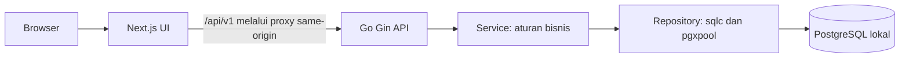
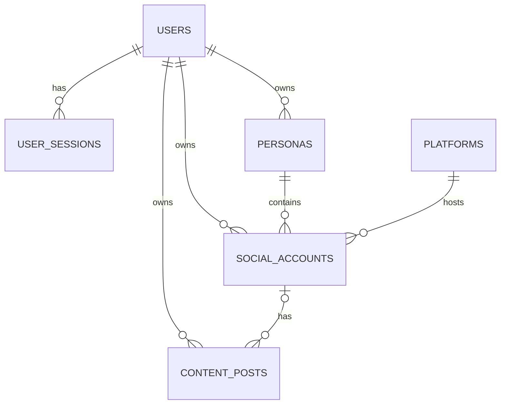
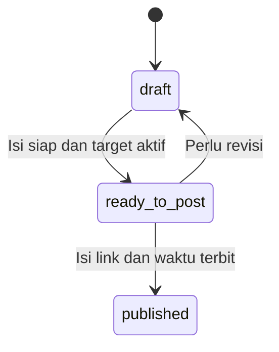

# MungkasDesk — Rencana Webapp Manajemen Konten, Fase 1

Tanggal: 9 November 2026  
Revisi: penyederhanaan tabel dan session sesuai review pengguna.  
Status: draft rencana untuk direview; belum ada implementasi, instalasi, atau koneksi database.

## 1. Tujuan dan keputusan utama

MungkasDesk membantu pemilik akun merencanakan konten teks, menyiapkan versi postingan untuk beberapa akun sosial media, melihat jadwal di kalender, dan mencatat postingan yang sudah diterbitkan secara manual.

Rekomendasi stack: **Go + Gin, PostgreSQL lokal, pgx + sqlc, Goose untuk SQL migration, serta Next.js App Router + TypeScript**. Kalender menggunakan FullCalendar Standard.

Model konten disederhanakan menjadi **satu tabel `content_posts`**. Satu baris menyimpan judul, teks, catatan, akun tujuan, status, jadwal, link publikasi, dan waktu publikasi. Tidak ada tabel konten induk.

Relasi utamanya: **persona → akun sosial → banyak postingan**. Jika teks yang sama akan diposting ke Threads dan Facebook, dibuat dua baris postingan yang independen. Masing-masing bisa mempunyai isi, status, dan jadwal berbeda.

Dokumen ini berisi rancangan. Semua direktori, endpoint, migration, dan pengujian yang disebut di bawah adalah pekerjaan implementasi mendatang.

## 2. Kebutuhan yang sudah dikonfirmasi

- Pencatatan dilakukan manual; tidak ada integrasi API sosial media di fase 1.
- Alur kerja mencakup ide, draft, siap posting, penjadwalan, dan pencatatan publikasi.
- Status postingan: `draft`, `ready_to_post`, dan `published`.
- Satu persona mempunyai beberapa akun, termasuk kemungkinan beberapa akun di platform yang sama.
- Satu konten dapat diposting ke beberapa akun/platform.
- Data publikasi awal cukup link dan tanggal/waktu posting.
- Isi konten terutama teks.
- Ada login; pengguna pertama hanya pemilik aplikasi.
- Tidak ada pengaturan zona waktu pengguna dan tidak ada field timezone pada tabel user.
- Session berakhir setelah **2 jam tanpa aktivitas pengguna**, bukan 2 jam sejak login.
- Platform cukup memakai `name` tanpa field kode tambahan.
- Persona hanya dapat diarsipkan/dipulihkan dari aplikasi; hard delete hanya lewat query database manual jika diperlukan.
- Akun sosial tidak memerlukan field handle/identifier tersendiri.
- Semua data konten/postingan disimpan langsung di `content_posts`.
- Platform awal: Threads dan Facebook.
- Halaman kalender bulanan besar menampilkan penanda postingan yang sudah `ready_to_post` dan mempunyai jadwal. Hover menampilkan detail singkat.

### Asumsi yang dipakai agar rencana konkret

Asumsi berikut adalah rekomendasi, belum merupakan jawaban eksplisit pengguna:

| Hal | Default fase 1 |
| --- | --- |
| Variasi isi | Isi postingan boleh berbeda untuk setiap akun |
| Akun login aplikasi | Satu pengguna awal, tanpa registrasi publik |
| Hosting awal | Development di localhost; deployment publik dibahas saat diperlukan |
| Zona waktu aplikasi | Tetap `Asia/Bangkok` melalui konfigurasi aplikasi, mengikuti lingkungan saat ini; tidak ada pengaturan timezone pada UI/login/user |
| Konten lintas akun | Salin teks ke baris postingan terpisah; tidak ada relasi pengelompokan konten induk |
| Ide tanpa akun | Boleh disimpan sebagai draft dengan `social_account_id = NULL`; pilih akun sebelum menjadi ready |
| Pengulangan konten | Akun yang sama boleh memiliki banyak postingan, termasuk teks yang sama pada jadwal berbeda |
| Media | Editor teks biasa; tidak ada upload gambar/video atau rich text pada fase 1 |
| Ready tanpa jadwal | Diizinkan; masuk daftar “Siap posting, belum dijadwalkan” |
| Publish manual | Link postingan dan waktu terbit wajib diisi |
| Pengingat | Kalender dan penanda terlambat di aplikasi; belum ada email/push notification |

Tidak perlu meminta kredensial PostgreSQL untuk menyelesaikan planning ini. Versi PostgreSQL lokal dan konfigurasi koneksi dicek saat implementasi sudah diminta.

## 3. Batas fase 1 dan fase berikutnya

### Fase 1

1. Login/logout dengan idle timeout 2 jam.
2. Pengelolaan persona dan pencatatan akun Threads/Facebook secara manual.
3. Pengelolaan ide dan postingan teks langsung di `content_posts`.
4. Pembuatan postingan untuk satu akun atau penyalinan ke beberapa akun.
5. Pengelolaan status dan jadwal per postingan.
6. Kalender bulanan, detail jadwal, filter, dan daftar postingan belum terjadwal.
7. Penandaan published secara manual beserta link dan waktu publikasi.
8. SQL migration dan dokumentasi pemindahan database ke device lain.

### Ditunda

- Pengambilan likes, komentar, views, share, dan riwayat statistik.
- OAuth, akses token, sinkronisasi akun, dan publikasi otomatis ke platform.
- Tim, role, approval, dan kolaborasi.
- Upload media, carousel, rich text, recurring schedule, drag-and-drop jadwal, serta notifikasi eksternal.

Fase 2 dapat menambahkan statistik yang mengacu ke `content_posts.id`. Publikasi otomatis perlu penilaian terpisah terhadap API dan izin masing-masing platform; keberadaan akun di fase 1 belum berarti akun tersebut terhubung melalui OAuth.

## 4. Rekomendasi backend Go

### Pilihan utama: Gin

Gin menyediakan routing, route groups, middleware, serta binding dan validasi JSON. Fitur tersebut cocok untuk REST API CRUD pada aplikasi ini. Pemilihan Gin adalah pertimbangan kemudahan implementasi, bukan kebutuhan mengejar benchmark. [Dokumentasi Gin](https://gin-gonic.com/en/docs/)

| Pilihan | Pertimbangan untuk aplikasi ini |
| --- | --- |
| **Gin — direkomendasikan** | Binding/validasi dan pengelompokan route tersedia; cocok untuk membangun API awal dengan pola konsisten |
| Chi | Alternatif jika lebih memilih handler standar `net/http` dan menyusun sendiri binding/validasi; kompatibilitas `net/http` menjadi karakter utama Chi |

Chi juga layak; memilih Gin di sini adalah keputusan desain untuk mempermudah pengerjaan API fase 1. [Dokumentasi Chi](https://github.com/go-chi/chi)

### Komponen pendukung

| Komponen | Rekomendasi dan peran |
| --- | --- |
| HTTP API | Gin, REST JSON dengan prefix `/api/v1` |
| Database | PostgreSQL lokal yang sudah tersedia |
| Driver/pool | `pgx/v5` dan `pgxpool` |
| Query | SQL eksplisit dengan kode Go yang dihasilkan sqlc |
| Migration | Goose dengan SQL versioned, bagian Up dan Down |
| Password | Argon2id melalui `golang.org/x/crypto/argon2`; salt acak per password |
| Session | Token acak dalam cookie HttpOnly; hash token disimpan di PostgreSQL |
| Logging | Structured logging dengan `log/slog` |
| Frontend | Next.js App Router, React, TypeScript |
| Kalender | FullCalendar Standard dengan tampilan month/day grid |

pgx menyediakan driver dan connection pool PostgreSQL. sqlc menghasilkan kode dari SQL dan dapat menggunakan migration sebagai sumber schema, tetapi tidak menjalankan migration. Goose menangani perubahan schema melalui migration tersendiri. [pgx](https://github.com/jackc/pgx), [sqlc code generation](https://docs.sqlc.dev/en/latest/howto/generate.html), [sqlc migrations](https://docs.sqlc.dev/en/stable/howto/ddl.html), [Goose](https://github.com/pressly/goose)

Next.js menyediakan App Router untuk struktur halaman. FullCalendar memiliki integrasi React; komponen kalender yang interaktif ditempatkan pada Client Component. Gunakan plugin Standard berlisensi MIT. Istilah “scheduler” di aplikasi ini berarti kalender jadwal konten; fitur resource scheduling Premium tidak diperlukan. [Next.js App Router](https://nextjs.org/docs/app), [FullCalendar React](https://fullcalendar.io/docs/react), [Lisensi FullCalendar](https://fullcalendar.io/license)

Versi patch dependency dipilih dan dikunci saat implementasi setelah memeriksa kompatibilitas Go, Node.js, Next.js, dan PostgreSQL lokal. Planning ini tidak mengharuskan upgrade PostgreSQL.

## 5. Arsitektur yang disarankan



- Frontend bertanggung jawab atas tampilan, form, kalender, dan interaksi.
- Backend menjadi sumber aturan bisnis, autentikasi, validasi, transaksi, dan akses database.
- Browser mengakses API melalui origin Next.js yang sama; proxy meneruskan request/cookie dan header `Set-Cookie` ke/dari Go. Backend tetap memeriksa autentikasi pada setiap request.
- Next.js tidak mengakses PostgreSQL secara langsung.
- Gunakan satu backend berbentuk modular monolith. Belum perlu microservices, Redis, queue, worker scheduler, atau cron.
- Mencapai waktu jadwal tidak mengubah status dan tidak memicu publikasi. “Terlambat” dihitung saat membaca data.

Struktur direktori yang direncanakan:

```text
MungkasDesk/
  PLAN.md
  backend/
    cmd/
      api/
      admin/                 # bootstrap user dan reset password lokal
    internal/
      config/
      http/                  # router, handler, middleware, DTO
      service/               # aturan bisnis dan transaksi
      repository/            # query sqlc dan kode hasil generate
    db/
      migrations/
      queries/
    sqlc.yaml
    .env.example
    go.mod
  frontend/
    src/
      app/                   # login, content-posts, calendar, settings
      components/
      features/
      lib/                   # API client, format tanggal, deteksi aktivitas
    .env.example
    package.json
  docs/
    local-setup.md
    database-portability.md
```

## 6. Model domain dan relasi

Modul Konten menggunakan tabel `content_posts` sebagai satu-satunya penyimpanan ide dan postingan. Akun sosial menghubungkan persona dengan platform.

| Entitas | Makna | Contoh |
| --- | --- | --- |
| User | Pengguna yang login ke MungkasDesk | Pemilik aplikasi |
| Persona | Identitas atau brand yang dikelola | Personal, Brand A |
| Platform | Jenis layanan sosial media | Threads, Facebook |
| Social account | Akun tertentu milik persona di platform | Akun Threads milik Personal |
| Content post | Ide/draft atau postingan untuk satu akun | Tips menulis, target Threads, ready besok pukul 09.00 |



Contoh: persona **Personal** memiliki akun **Threads Personal** dan **Facebook Personal**. Threads Personal mempunyai postingan A dan B; Facebook Personal mempunyai postingan C. Bila A juga ingin diposting ke Facebook, salin menjadi postingan D dengan target Facebook Personal. A dan D berdiri sendiri, termasuk setelah salah satunya diedit atau published.

Setiap postingan mempunyai nol atau satu akun tujuan: nol hanya saat draft/ide. Satu akun mempunyai banyak postingan. Persona dan platform postingan diperoleh lewat akun, sehingga tidak perlu diduplikasi sebagai field pada postingan.

Pada rancangan sebelumnya, tabel konten induk dipakai untuk mengelompokkan satu ide yang diterbitkan ke beberapa akun. Sesuai revisi, pengelompokan tersebut dihapus. Tidak ada field `content_id`, status agregat, atau sinkronisasi teks antarakun.

## 7. Konvensi database

- Nama tabel plural dan field `snake_case` dalam bahasa Inggris.
- Semua tabel domain memakai primary key `id UUID`, dibuat oleh backend agar tidak bergantung pada extension database tertentu.
- Foreign key mengikuti pola `<entity>_id`.
- Semua tabel di bawah mempunyai `created_at TIMESTAMPTZ NOT NULL DEFAULT now()` dan `updated_at TIMESTAMPTZ NOT NULL DEFAULT now()`. Keduanya tidak diulang pada setiap tabel untuk mempersingkat daftar.
- Backend memperbarui `updated_at` pada setiap mutasi; database default hanya mengisi nilai awal.
- Timestamp menyimpan waktu absolut; API mengirim RFC 3339 dengan offset/`Z`. Kalender menggunakan satu zona aplikasi dari `APP_TIMEZONE`, default `Asia/Bangkok`.
- `TIMESTAMPTZ` tidak menyimpan nama zona waktu IANA. Zona tampilan berasal dari konfigurasi aplikasi, tanpa field timezone di database user. [PostgreSQL date/time](https://www.postgresql.org/docs/current/datatype-datetime.html)
- Field opsional menggunakan SQL `NULL`, bukan string kosong; `body` adalah pengecualian yang boleh `''` selama draft.
- Status memakai `TEXT` dengan `CHECK`, agar penambahan status berikutnya dilakukan melalui migration yang jelas.
- Penghapusan entitas bisnis menggunakan arsip; foreign key memakai `ON DELETE RESTRICT`. Session boleh dihapus saat kedaluwarsa/logout.
- `user_id` selalu berasal dari session login, tidak dipercaya dari body request.

## 8. Tabel dan nama field

### 8.1 `users`

| Field | Tipe | Aturan / fungsi |
| --- | --- | --- |
| `id` | UUID | PK |
| `email` | TEXT | NOT NULL; trim + lowercase; unique pada `lower(email)` |
| `display_name` | VARCHAR(100) | NOT NULL, tidak boleh whitespace saja |
| `password_hash` | TEXT | NOT NULL; encoded hash Argon2id termasuk parameter dan salt |
| `is_active` | BOOLEAN | NOT NULL, default true |
| `last_login_at` | TIMESTAMPTZ | NULL jika belum login |

Tidak ada kolom role pada fase 1. User awal dibuat melalui perintah admin interaktif saat implementasi, tanpa menyimpan password di migration atau seed. Reset password memakai jalur admin lokal; reset email ditunda.

### 8.2 `user_sessions`

| Field | Tipe | Aturan / fungsi |
| --- | --- | --- |
| `id` | UUID | PK |
| `user_id` | UUID | NOT NULL, FK → users |
| `token_hash` | BYTEA | NOT NULL, UNIQUE; hash SHA-256 dari token acak 32 byte |
| `last_activity_at` | TIMESTAMPTZ | NOT NULL; waktu aktivitas terakhir yang diterima backend; diisi saat login |
| `expires_at` | TIMESTAMPTZ | NOT NULL; `last_activity_at + interval '2 hours'` |

Token asli hanya disimpan di cookie browser. Backend memeriksa expiry dan `users.is_active` pada setiap request. Aktivitas pengguna yang valid memperbarui `last_activity_at` dan `expires_at` secara atomik, serta memperbarui masa berlaku cookie. Session yang sudah expired tidak boleh diaktifkan kembali oleh heartbeat atau request baru; harus login ulang.

Tambahkan `CHECK (expires_at = last_activity_at + interval '2 hours')` agar kebijakan idle timeout konsisten. Definisi aktivitas, polling, dan logout otomatis dijelaskan di bagian 13. Logout menghapus session; cleanup session kedaluwarsa dapat dijalankan lewat perintah admin tanpa worker khusus.

### 8.3 `platforms`

| Field | Tipe | Aturan / fungsi |
| --- | --- | --- |
| `id` | UUID | PK |
| `name` | VARCHAR(100) | NOT NULL; nama platform, contoh `Threads`, `Facebook`; unique case-insensitive |
| `is_active` | BOOLEAN | NOT NULL, default true |

Master global, bukan milik user tertentu. Seed awal memasukkan Threads dan Facebook. Gunakan unique index `lower(name)` untuk mencegah nama ganda. Relasi tetap menggunakan `platform_id`, sehingga perubahan nama tidak mengubah referensi akun. Fase 1 hanya perlu endpoint baca; penambahan platform dilakukan melalui migration berikutnya.

### 8.4 `personas`

| Field | Tipe | Aturan / fungsi |
| --- | --- | --- |
| `id` | UUID | PK |
| `user_id` | UUID | NOT NULL, FK → users |
| `name` | VARCHAR(100) | NOT NULL; unik per user secara case-insensitive |
| `description` | TEXT | NULL; keterangan identitas atau gaya bicara |
| `archived_at` | TIMESTAMPTZ | NULL saat aktif |

Tambahkan `UNIQUE (user_id, id)` untuk target composite foreign key. Nama persona tetap unik termasuk arsip, supaya pemulihan tidak menghasilkan konflik nama.

Frontend hanya menyediakan buat, edit, arsip, dan pulihkan persona. Tidak ada tombol delete, endpoint DELETE, maupun fitur hard delete pada perintah admin aplikasi. `archived_at` menandai persona yang sedang di-hold/soft delete. Jika hard delete benar-benar diperlukan, lakukan melalui query database manual; FK tetap `RESTRICT`, sehingga data akun/postingan terkait harus ditangani secara eksplisit terlebih dahulu. Dokumen ini tidak menjalankan penghapusan apa pun.

### 8.5 `social_accounts`

| Field | Tipe | Aturan / fungsi |
| --- | --- | --- |
| `id` | UUID | PK |
| `user_id` | UUID | NOT NULL, FK → users |
| `persona_id` | UUID | NOT NULL; persona pemilik akun |
| `platform_id` | UUID | NOT NULL, FK → platforms |
| `display_name` | VARCHAR(150) | NOT NULL; label akun untuk dropdown/kalender |
| `profile_url` | TEXT | NULL; URL profil HTTP/HTTPS |
| `notes` | TEXT | NULL |
| `archived_at` | TIMESTAMPTZ | NULL saat aktif |

- Composite FK `(user_id, persona_id)` → `personas(user_id, id)` memastikan akun tidak menunjuk persona user lain.
- Tambahkan `UNIQUE (user_id, id)` untuk relasi dari postingan.
- Identitas internal menggunakan `id`; nama akun menggunakan `display_name`, dan tautan profil boleh disimpan pada `profile_url`. Tidak ada field handle/ID platform tambahan.
- Tanpa identifier platform, aplikasi tidak menjamin deteksi akun sosial yang sama jika dicatat dua kali. Nama tampilan tidak dijadikan unique key karena beberapa akun dapat memakai nama sama.
- Tidak ada constraint unik `(persona_id, platform_id)`: satu persona boleh mempunyai dua akun Threads.
- Identitas platform dan persona akun dikunci setelah akun mempunyai postingan agar riwayat tidak berpindah makna; koreksi identitas dilakukan dengan membuat akun baru. Nama tampilan dan URL profil tetap boleh diperbarui.
- Tidak menyimpan password sosial media atau access token.

### 8.6 `content_posts`

| Field | Tipe | Aturan / fungsi |
| --- | --- | --- |
| `id` | UUID | PK |
| `user_id` | UUID | NOT NULL, FK → users |
| `social_account_id` | UUID | NULL selama draft/ide; wajib saat ready atau published |
| `title` | VARCHAR(200) | NOT NULL; judul internal, tidak harus ikut diposting |
| `body` | TEXT | NOT NULL, default `''`; teks postingan |
| `notes` | TEXT | NULL; catatan internal |
| `status` | TEXT | NOT NULL, default `draft`; CHECK tiga status yang disepakati |
| `scheduled_at` | TIMESTAMPTZ | NULL jika belum dijadwalkan; tetap disimpan setelah published |
| `published_at` | TIMESTAMPTZ | NULL sampai ditandai published; waktu terbit aktual |
| `published_url` | TEXT | NULL sampai ditandai published; URL postingan |
| `archived_at` | TIMESTAMPTZ | NULL saat aktif; arsip menyembunyikan postingan dari daftar aktif/kalender |

Constraint utama:

1. Composite FK `(user_id, social_account_id)` → `social_accounts(user_id, id)`; NULL hanya diperbolehkan untuk draft, tanpa melemahkan kewajiban `user_id`.
2. `status IN ('draft', 'ready_to_post', 'published')`.
3. `title` wajib memiliki `length(btrim(title)) > 0`.
4. `ready_to_post` dan `published` wajib memiliki `social_account_id IS NOT NULL` dan `length(btrim(body)) > 0`.
5. `published` wajib memiliki `published_at` dan `published_url` yang tidak kosong; status lain wajib memiliki keduanya NULL.
6. Validasi format URL HTTP/HTTPS, waktu publikasi tidak di masa depan, dan perubahan status dilakukan backend. Jangan memakai CHECK berbasis `now()` untuk aturan yang berubah seiring waktu.
7. Tidak ada unique constraint untuk teks atau akun tujuan: satu akun boleh mempunyai banyak postingan, termasuk repost dengan teks yang sama.

Ide adalah draft yang belum lengkap, bukan tabel/status tambahan. Menyimpan judul saja tetap diperbolehkan. Saat menyalin postingan ke akun lain, buat row baru berstatus draft dengan judul/teks/catatan tersalin; jadwal, link, dan waktu publikasi dikosongkan. Semua row hasil salin berdiri sendiri.

## 9. Status, aturan jadwal, dan integritas

### Transisi postingan



- `draft`: akun dan teks boleh belum diisi; jadwal boleh NULL atau terisi sebagai rencana sementara. Tidak tampil pada kalender utama. Pada UI dapat diberi label “Ide” jika akun/teks belum lengkap, tetapi nilai status database tetap draft.
- `ready_to_post`: teks wajib terisi. Jadwal boleh NULL, sehingga kesiapan dan penjadwalan tidak dicampur menjadi status berbeda.
- `published`: ditandai manual dari ready. Link dan waktu aktual wajib; jadwal lama tetap tersimpan untuk membandingkan rencana dengan realisasi.
- Edit teks pada postingan ready mengembalikan status ke draft dalam transaksi yang sama. Jadwal tetap disimpan dan postingan keluar dari kalender sampai ditandai ready lagi.
- Mengubah jadwal postingan ready mempertahankan status ready. Jadwal baru/perubahan jadwal harus di masa depan.
- Postingan ready yang waktunya terlewat tetap ready dengan indikator `is_overdue`, bukan status baru. Menandainya published dengan waktu terbit lampau tetap diperbolehkan.
- Tidak ada transisi otomatis berdasarkan jam. Tidak ada status `scheduled` tambahan.
- Postingan published bersifat read-only untuk judul, teks, akun, status, dan jadwal; koreksi link/waktu aktual diperbolehkan lewat aksi khusus. Catatan internal tetap boleh diedit. Pengeditan postingan di platform tidak disinkronkan pada fase 1.
- Mengganti akun pada postingan ready mengembalikannya ke draft; akun baru harus milik user yang sama.
- Saat membuat postingan untuk beberapa akun sekaligus, backend membuat satu row per akun dalam satu transaksi. Target tidak valid atau ID akun berulang dalam payload yang sama menggagalkan seluruh operasi. Postingan yang sudah ada pada akun yang sama tidak menghalangi pembuatan postingan baru.
- Tidak ada status gabungan “sebagian published”; daftar menampilkan status masing-masing postingan secara langsung.

### Arsip dan kepemilikan

- Arsip digunakan untuk postingan, persona, dan akun. Pemulihan arsip tersedia.
- Persona bisa diarsipkan untuk hold tanpa menghapus data akun/postingan. Postingan ready di bawah persona tersebut keluar dari kalender aktif, sementara status dan jadwalnya tetap tersimpan.
- Arsip persona tidak mengarsipkan akun secara permanen; akun di bawahnya dianggap tidak tersedia selama persona diarsipkan.
- Arsip akun atau postingan juga mengeluarkan jadwalnya dari kalender tanpa mengubah status. Pemulihan mengembalikan jadwal yang memenuhi syarat; jadwal yang sudah lewat ditandai overdue.
- Draft tanpa akun tetap bisa disimpan. Memilih akun, membuat salinan target, dan transisi ke ready memerlukan postingan, akun, persona, dan platform yang aktif.
- Riwayat published tetap dapat dibaca, termasuk saat postingan/akun/personanya diarsipkan.
- Tidak ada hard delete persona dari frontend maupun API. Penghapusan manual database tidak melakukan cascade otomatis.
- Setiap query data milik pengguna harus dibatasi `user_id`. Composite FK memberikan perlindungan tambahan pada relasi.
- Perubahan status memakai update bersyarat terhadap status sebelumnya agar publish/revisi bersamaan tidak saling menimpa tanpa terdeteksi; konflik dibalas HTTP 409.

## 10. Kalender scheduler

### Tampilan dan sumber data

- Route `/calendar`, tampilan bulanan besar dengan navigasi bulan, tombol Hari Ini, dan nama zona waktu aktif.
- **Satu titik/penanda mewakili satu baris `content_posts`**. Teks yang sama pada dua akun tetap menghasilkan dua postingan/jadwal independen.
- Kalender utama hanya mengambil `status = 'ready_to_post'` dengan `scheduled_at IS NOT NULL`, postingan tidak diarsipkan, serta akun/persona/platform aktif.
- Jadwal yang sudah lewat tetap tampil pada tanggal aslinya dengan indikator terlambat.
- Postingan published keluar dari kalender rencana dan dapat dibaca di daftar riwayat published.
- Panel “Siap posting, belum dijadwalkan” menampung ready dengan jadwal NULL yang postingan/akun/persona/platformnya aktif.
- Filter platform, persona, dan akun diterapkan di backend.

### Interaksi

1. Hover atau fokus keyboard pada penanda menampilkan judul konten, cuplikan teks versi akun, persona, platform, akun, jam, zona waktu, dan status.
2. Klik/tap membuka panel detail yang sama dan aksi edit jadwal, salin teks, atau tandai published.
3. Penanda mempunyai label aksesibel dan area interaksi yang cukup besar; tooltip tidak mengandalkan warna saja.
4. Klik tanggal membuka form penjadwalan untuk postingan ready yang belum terjadwal.
5. Banyak jadwal dalam satu tanggal ditampilkan terbatas disertai “+N lainnya”; klik membuka daftar hari tersebut.
6. Di layar kecil tersedia daftar agenda agar detail tetap mudah dibaca.
7. Perubahan data menampilkan feedback loading, berhasil, dan gagal. Form gagal tetap mempertahankan input pengguna.

Panduan interaksi menggunakan prioritas aksesibilitas dan touch dari skill `ui-ux-pro-max`; pencarian/generasi design system melalui script ditunda mengikuti batas planning pengguna. Warna, font, dan visual design system belum ditetapkan oleh dokumen ini.

### Kontrak waktu kalender

- Backend menerima rentang `[from, to)`: awal inklusif, akhir eksklusif, dalam RFC 3339 dengan offset eksplisit.
- Frontend mengonversi batas kalender dari zona waktu aplikasi menjadi waktu absolut. Rentang mengikuti seluruh sel kalender yang terlihat, termasuk tanggal bulan tetangga.
- Komponen kalender dikonfigurasi menggunakan `APP_TIMEZONE`, bukan otomatis mengikuti zona mesin browser. Pilih dukungan named timezone FullCalendar yang kompatibel saat implementasi.
- Zona waktu ditetapkan lewat konfigurasi aplikasi; tidak ada dropdown timezone, field timezone user, atau endpoint untuk mengganti preferensi zona waktu.
- Response event hanya memuat ID, judul, cuplikan, target, status, waktu, dan indikator terlambat. Teks lengkap dimuat saat detail dibuka.
- Refetch saat mengganti bulan/filter, setelah mutasi, saat jendela kembali aktif, dan secara berkala sekitar 60 detik selama kalender terbuka. Tampilkan empty/error/loading state. Refetch/polling otomatis tidak memperpanjang session.

## 11. Index database awal

Di luar primary key, unique key, dan composite key yang sudah dijelaskan:

| Tabel | Index | Tujuan |
| --- | --- | --- |
| `users` | UNIQUE `lower(email)` | Lookup login dan cegah email ganda |
| `user_sessions` | `(user_id)`, `(expires_at)` | Daftar session dan cleanup |
| `platforms` | UNIQUE `lower(name)` | Cegah nama platform ganda tanpa field kode |
| `personas` | UNIQUE `(user_id, lower(name))` | Nama unik dan lookup persona |
| `social_accounts` | `(user_id, persona_id)`, `(platform_id)` | Filter akun dan foreign key |
| `content_posts` | `(user_id, created_at DESC, id DESC)` | Daftar ide/postingan dengan urutan stabil |
| `content_posts` | `(user_id, status, created_at DESC)` | Filter status dan daftar siap posting |
| `content_posts` | `(user_id, scheduled_at) WHERE status = 'ready_to_post' AND scheduled_at IS NOT NULL` | Query rentang kalender |
| `content_posts` | `(user_id, social_account_id)` | Lookup postingan akun |
| `content_posts` | `(user_id, published_at DESC) WHERE status = 'published'` | Riwayat publikasi |

Pencarian judul/teks awal cukup `ILIKE` dengan parameter query; full-text/trigram index baru ditambahkan bila volume dan pengukuran membutuhkan.

## 12. Rencana API

Semua endpoint bisnis berada di `/api/v1`, memerlukan session aktif, dan membatasi data ke user login.

| Method | Endpoint | Tujuan |
| --- | --- | --- |
| POST | `/auth/login` | Verifikasi email/password dan buat session |
| POST | `/auth/logout` | Hapus session dan cookie |
| POST | `/auth/activity` | Perbarui idle timeout hanya karena aktivitas pengguna baru |
| GET | `/auth/me` | Data pengguna aktif |
| PATCH | `/me` | Ubah display name; tidak ada field timezone |
| GET | `/platforms` | Master platform |
| GET / POST | `/personas` | List dan buat persona |
| GET / PATCH | `/personas/{id}` | Detail dan edit persona |
| POST | `/personas/{id}/archive`, `/personas/{id}/restore` | Kelola arsip persona |
| GET / POST | `/social-accounts` | List dan buat akun |
| GET / PATCH | `/social-accounts/{id}` | Detail dan edit akun |
| POST | `/social-accounts/{id}/archive`, `/social-accounts/{id}/restore` | Kelola arsip akun |
| GET / POST | `/content-posts` | List/filter/search dan buat ide atau postingan untuk satu akun |
| POST | `/content-posts/bulk` | Buat postingan untuk beberapa akun secara atomik |
| GET / PATCH | `/content-posts/{id}` | Detail/edit judul, teks, akun, jadwal, atau catatan; published hanya boleh edit catatan |
| POST | `/content-posts/{id}/copies` | Salin judul/teks/catatan ke akun pilihan sebagai draft baru |
| POST | `/content-posts/{id}/archive`, `/content-posts/{id}/restore` | Kelola arsip postingan |
| POST | `/content-posts/{id}/mark-ready` | Draft → ready |
| POST | `/content-posts/{id}/return-to-draft` | Ready → draft |
| POST | `/content-posts/{id}/publish` | Ready → published dengan `published_url`, `published_at` |
| PATCH | `/content-posts/{id}/publication` | Koreksi link/waktu aktual postingan published |
| GET | `/calendar/events` | Rentang jadwal ready, misalnya `?from=...&to=...&platform_id=...` |

List biasa memakai `page`, `page_size`, batas maksimal 100, dan urutan stabil. Query kalender memakai rentang waktu dengan batas maksimal 62 hari per request; seluruh event dalam rentang dikembalikan agar penanda tidak terpotong oleh pagination list.

Response list berisi `data` dan `meta`. Error berbentuk `{ "error": { "code": "...", "message": "...", "fields": {} } }`. Gunakan 400 untuk payload tidak valid, 401 untuk tidak login, 404 untuk data tidak ada/tidak dimiliki user, 409 untuk konflik/duplikasi/transisi status, dan 422 untuk validasi bisnis.

`status`, `user_id`, `published_url`, dan `published_at` tidak boleh diubah lewat PATCH umum; gunakan aksi khusus agar aturan transisi konsisten. Arsip pada PATCH umum juga dilarang.

List postingan mendukung filter status, akun, persona, platform, arsip, draft tanpa akun, serta ready belum terjadwal. Route statis seperti `/content-posts/bulk` harus didaftarkan agar tidak tertangkap sebagai parameter `{id}`. Tidak ada endpoint konten induk dan tidak ada endpoint DELETE persona.

## 13. Login dan keamanan dasar

### Session berakhir setelah 2 jam tanpa aktivitas

- Saat login, isi `last_activity_at` dengan waktu server dan `expires_at` dua jam setelahnya. Tidak ada TTL tetap tujuh hari atau logout dua jam sejak login jika user terus aktif.
- Response login, pengecekan session, dan pembaruan aktivitas menyertakan `expires_at` agar frontend dapat mengikuti deadline dari server; token tetap hanya di cookie.
- Aktivitas mencakup interaksi pengguna seperti mengetik, gerakan/klik pointer, scroll, sentuhan, navigasi manual, dan submit form. Membiarkan halaman terbuka, fetch otomatis, polling kalender, atau timer yang berjalan sendiri tidak termasuk aktivitas.
- Frontend mengamati event input pengguna dan mengirim `/auth/activity` secara terbatas, misalnya maksimal satu kali per 30 detik bila ada interaksi baru. Saat jeda lebih panjang, interaksi pertama mengirim activity segera. Timer tanpa interaksi baru tidak mengirim activity.
- Request aksi bisnis yang dipicu pengguna juga memperbarui idle deadline. Background GET, `/auth/me`, dan query kalender tidak otomatis memperbaruinya; frontend memberi sinyal aktivitas secara terpisah.
- Backend memakai waktu penerimaan aktivitas pada server, bukan timestamp yang dikirim client. Update harus bersyarat `expires_at > now()` agar activity tidak menghidupkan session yang sudah expired.
- Pada setiap request, `now() >= expires_at` menghasilkan HTTP 401 dan penghapusan cookie. Frontend mengarahkan user ke login dan menjelaskan session berakhir karena tidak aktif.
- Frontend menggunakan `expires_at` dari backend untuk logout saat deadline tercapai walaupun tidak ada request API. Jika tab sedang ditangguhkan browser, deadline diperiksa lagi saat tab aktif. Backend tetap menjadi penentu validitas session.
- Aktivitas di beberapa tab dengan token session yang sama memperpanjang session yang sama. Sinkronkan deadline/logout antartab melalui BroadcastChannel atau storage event agar tab idle tidak mengeluarkan user yang aktif di tab lain; tab memverifikasi deadline ke backend sebelum memutuskan session berakhir.
- Masa berlaku cookie mengikuti deadline idle terbaru. Tidak ada heartbeat yang terus memperpanjang session saat user meninggalkan aplikasi.

### Keamanan dasar

- Login email/password, dengan Argon2id dan parameter hashing yang dipilih saat implementasi. [Paket Argon2 Go](https://pkg.go.dev/golang.org/x/crypto/argon2)
- Token session dihasilkan dengan `crypto/rand`, diganti pada login, dan tidak dimasukkan ke response JSON/localStorage.
- Cookie menggunakan `HttpOnly`, `SameSite=Lax`, `Path=/`; `Secure` aktif saat HTTPS. Pengecualian HTTP hanya untuk development localhost.
- Logout/password reset mencabut session terkait; password reset admin mencabut semua session user.
- Untuk mutasi melalui cookie, backend memverifikasi `Origin` terhadap origin aplikasi yang dikonfigurasi, termasuk pada login; origin lain atau Origin yang hilang ditolak untuk request browser yang mengubah state.
- Proxy meneruskan header yang diperlukan tanpa mengubah target validasi origin; browser tidak menggunakan Go API lintas origin.
- Login mempunyai rate limit dan pesan gagal generik. Query SQL selalu berparameter, ukuran body dibatasi, dan respons error tidak mengekspos detail koneksi.
- Password, token, cookie, dan connection string tidak dicatat di log atau dimasukkan ke Git. Cookie/session mengikuti prinsip penyimpanan session di server. [OWASP Session Management](https://cheatsheetseries.owasp.org/cheatsheets/Session_Management_Cheat_Sheet.html)

## 14. Strategi migration dan pindah device

### File migration yang akan dibuat

| File rencana | Isi Up |
| --- | --- |
| `00001_create_users_and_sessions.sql` | users, user_sessions, index autentikasi |
| `00002_create_platforms_personas_accounts.sql` | master platform, persona, akun, constraint |
| `00003_create_content_posts.sql` | seluruh data ide/postingan, CHECK, FK, index; tanpa tabel konten induk |
| `00004_seed_initial_platforms.sql` | Threads dan Facebook dengan UUID tetap yang dicatat dalam migration |

- Setiap file mempunyai bagian `-- +goose Up` dan `-- +goose Down`; Goose mendukung SQL migration dan transaksi secara default. [Format migration Goose](https://github.com/pressly/goose#sql-migrations)
- Pakai nomor berpadding agar urutan lexicographic sama dengan urutan migration untuk sqlc.
- Down menghapus objek dalam urutan kebalikan dependency. Down seed menghapus hanya dua platform seed dan akan ditolak FK bila sudah dipakai akun; jangan cascade menghapus data pengguna.
- Migration yang sudah diterapkan tidak diedit. Perubahan schema ditambahkan sebagai file baru.
- sqlc memakai direktori migration sebagai sumber schema; tidak mengandalkan ORM auto-migrate.
- Migration dijalankan sebagai langkah eksplisit sebelum aplikasi dijalankan, bukan diam-diam setiap API start.
- Rollback yang menghapus tabel berarti menghapus data; di database berisi data gunakan backup dan utamakan forward migration perbaikan.
- Password user awal dibuat terpisah dari migration. Seed tidak berisi akun login atau rahasia.

### Dua kebutuhan pemindahan yang berbeda

**A. Device baru dengan database kosong:** ambil source code, siapkan database kosong, isi konfigurasi lokal, jalankan seluruh migration, lalu bootstrap user. Hasilnya struktur dan master platform yang sama, tanpa konten lama.

**B. Device baru dengan data lama:** ekspor database lama menggunakan `pg_dump` format custom, lalu restore ke database kosong memakai `pg_restore`. Backup harus menyertakan schema, data, dan tabel versi Goose; session lama dihapus setelah restore agar login ulang. Setelah restore, jalankan migration yang lebih baru daripada versi database tersebut. Jangan menjalankan seluruh migration ke database kosong sebelum memulihkan backup yang sudah mengandung schema. [PostgreSQL pg_dump](https://www.postgresql.org/docs/current/app-pgdump.html)

Dokumentasi implementasi perlu menjelaskan opsi owner/role saat restore ke user database berbeda, kompatibilitas versi tool PostgreSQL, verifikasi jumlah data, serta pengujian login dan kalender setelah restore. Backup disimpan di luar Git.

**Migration mereproduksi struktur database; pemindahan data lama memerlukan backup/restore.** Tidak ada ekspor, restore, atau migration yang dijalankan pada tahap planning.

Konfigurasi yang direncanakan:

| Lokasi | Variabel contoh |
| --- | --- |
| Backend | `DATABASE_URL`, `HTTP_ADDR`, `APP_ORIGIN`, `APP_TIMEZONE`, `SESSION_IDLE_TIMEOUT=2h`, `COOKIE_SECURE`, `APP_ENV` |
| Frontend server | `BACKEND_INTERNAL_URL`; zona aplikasi dibaca dari konfigurasi server yang sama |
| Goose | `GOOSE_DRIVER`, `GOOSE_DBSTRING`, `GOOSE_MIGRATION_DIR` |

`.env.example` hanya memuat placeholder. Goose dan backend harus diarahkan ke database yang sama; kredensial hanya ada pada konfigurasi lokal.

## 15. Halaman fase 1

| Route | Isi utama |
| --- | --- |
| `/login` | Form login |
| `/content-posts` | Daftar ide/postingan, pencarian, filter status, persona, platform, akun |
| `/content-posts/new` | Buat draft; pilih satu/beberapa akun untuk membuat postingan independen |
| `/content-posts/{id}` | Editor postingan, akun tujuan, jadwal, aksi status, dan salin ke akun lain |
| `/calendar` | Kalender bulanan dan daftar ready belum terjadwal |
| `/settings/personas` | List, tambah, edit, arsip, pulihkan persona |
| `/settings/accounts` | Pencatatan akun manual dan pengelolaannya |
| `/settings/profile` | Nama pengguna; tanpa pengaturan timezone |

Login berhasil mengarah ke kalender. Halaman detail hanya mengedit satu postingan. Aksi “Salin ke akun lain” membuat draft baru yang independen; tidak ada editor induk atau pengelompokan beberapa versi. Tombol “Salin teks” membantu memindahkan teks ke aplikasi sosial media; user kembali ke MungkasDesk untuk mencatat publikasi. Halaman persona tidak mempunyai tombol hapus.

## 16. Tahapan implementasi mendatang

1. **Fondasi:** periksa versi tool yang sudah ada, pilih versi dependency, susun backend/frontend dan konfigurasi contoh.
2. **Database:** tulis migration, constraint, index, seed platform, dan query sqlc; verifikasi pada database uji terpisah.
3. **Autentikasi:** bootstrap user, login/logout, idle timeout 2 jam, deteksi aktivitas, sinkronisasi tab, validasi origin, dan pembatasan akses.
4. **Master data:** buat/baca/edit/arsip/pulihkan persona dan akun sosial; tanpa fitur delete persona.
5. **Konten:** satu tabel postingan untuk ide/draft, pembuatan multiakun atomik, editor postingan, dan salin ke akun lain.
6. **Workflow:** validasi ready, jadwal, publish manual, serta koreksi link/waktu terbit.
7. **Kalender:** event per akun, filter, hover/focus/click detail, panel belum terjadwal, dan tampilan layar kecil.
8. **Verifikasi dan dokumentasi:** skenario bisnis, setup lokal, migration, dan pemindahan database.

Tidak ada durasi yang dijanjikan sebelum implementasi dan kondisi environment dinilai. Saat ini hanya dokumen planning yang direvisi; implementasi menunggu instruksi pengguna berikutnya.

## 17. Acceptance criteria dan rencana verifikasi

Pengujian berikut merupakan rencana, belum dijalankan:

- Bisa login/logout; request tanpa session dan session expired ditolak.
- Aktivitas pada menit ke-110 memperpanjang deadline menjadi dua jam setelah aktivitas itu; user tidak logout hanya karena dua jam berlalu sejak login.
- Tanpa interaksi selama dua jam, session berakhir meskipun kalender terus polling. Deadline idle yang sudah lewat tidak dapat diperpanjang oleh heartbeat terlambat.
- Aktivitas pada tab A memperbarui deadline tab B; tab yang kembali dari suspend memeriksa expiry sebelum melanjutkan.
- Tidak ada field timezone pada user, pengaturan timezone di UI, field kode platform, atau identifier akun tambahan pada schema/API.
- Nama platform unik secara case-insensitive; relasi akun tetap memakai ID platform.
- Persona Personal bisa mempunyai akun Threads dan Facebook, serta dua akun pada platform yang sama.
- Satu akun mempunyai banyak postingan. Persona hanya dapat diarsipkan/dipulihkan lewat aplikasi; tidak ada tombol atau endpoint hard delete.
- Ide dapat disimpan hanya dengan judul dan belum muncul di kalender.
- Draft tanpa akun/teks tidak bisa ditandai ready.
- Pembuatan ke dua akun menghasilkan dua baris postingan independen, bukan konten induk dan tabel turunannya.
- Menyalin postingan ke akun lain menghasilkan draft baru dengan jadwal/link/waktu publikasi kosong; edit salah satunya tidak mengubah yang lain.
- Draft dengan jadwal tidak muncul di kalender; ready tanpa jadwal masuk daftar belum terjadwal.
- Mengubah draft menjadi ready tanpa isi ditolak.
- Ready yang mempunyai jadwal muncul tepat pada tanggal/jam zona aplikasi, termasuk di batas pergantian hari/bulan.
- Query kalender memakai akhir eksklusif: event tepat di batas akhir tidak muncul dua kali pada rentang bersebelahan.
- Hover/focus/tap membuka informasi jadwal; banyak event pada satu tanggal tetap bisa dijangkau.
- Mengedit teks ready mengembalikannya ke draft dan menghapusnya dari kalender utama.
- Postingan overdue tetap ready; aplikasi tidak mengubahnya menjadi published secara otomatis.
- Publish tanpa link/waktu ditolak. Published menghilang dari kalender rencana dan muncul di riwayat.
- Postingan Threads yang sudah published tidak mengubah status postingan Facebook yang masih draft.
- ID akun berulang dalam payload bulk dan operasi bulk dengan satu akun tidak valid ditolak tanpa hasil parsial. Akun yang sudah mempunyai postingan tetap bisa menerima postingan baru dengan teks sama.
- Akses/relasi lintas user ditolak; user kedua hanya diperlukan sebagai fixture pengujian, bukan fitur registrasi.
- Arsip persona untuk hold menyembunyikan jadwal ready dari kalender tanpa menghapus postingan; pemulihan memunculkannya kembali dan menandai overdue jika perlu. Riwayat published tetap terbaca.
- Migration Up berhasil pada PostgreSQL uji kosong. Down/Up diuji pada database uji yang boleh dibuang, bukan database lokal berisi data pengguna.
- Backup/restore pada database uji mempertahankan konten, relasi, jadwal, dan versi migration; setelah session dibersihkan, login ulang berhasil.

Fokus pengujian implementasi pada idle session, aturan status, ownership, transaksi multiakun, dan konversi waktu; lakukan integrasi PostgreSQL untuk constraint/migration dan pemeriksaan browser untuk alur kalender. Tidak ada test, server, atau toolchain yang dijalankan hanya untuk memvalidasi dokumen planning.

## 18. Ringkasan keputusan untuk review

- Backend **Gin** dengan query SQL melalui **pgx + sqlc**.
- Database **PostgreSQL lokal**, schema versioned dengan **Goose SQL migration**.
- Frontend **Next.js + TypeScript** dan **FullCalendar Standard**.
- Schema terdiri dari **6 tabel**: `users`, `user_sessions`, `platforms`, `personas`, `social_accounts`, dan `content_posts`.
- Akun sosial berada di bawah persona dan memiliki banyak postingan. Satu postingan menyimpan seluruh data konten beserta status/jadwalnya; draft boleh belum memilih akun.
- Tidak ada tabel konten induk, field timezone user, kode platform, atau identifier akun tambahan.
- Persona hanya arsip/pulihkan melalui aplikasi; hard delete hanya lewat query database manual jika diperlukan.
- Login/logout menggunakan session yang expired setelah dua jam tanpa aktivitas; polling otomatis tidak memperpanjangnya.
- Kalender adalah perencanaan posting manual, dengan penanda untuk ready yang mempunyai jadwal.
- Fase berikutnya dapat menambah statistik atau integrasi platform tanpa mencampurkan status beberapa akun ke satu field konten.
